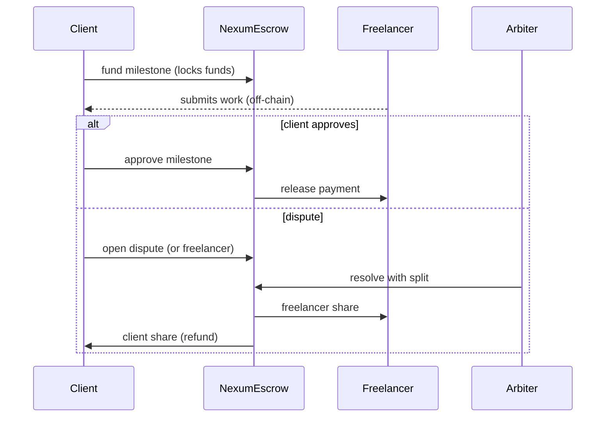

# Nexum – Freelance Marketplace with Milestone Escrow

A freelance marketplace where clients fund work in milestones and freelancers get paid only after
each milestone is approved. Disputes go to an arbiter who can split the locked funds.

**Phase 1 (done):** full-stack MVP with simulated escrow in PostgreSQL. Both main flows (invite and
public job board) work end to end in the browser.
**Phase 2 (in development):** replace the simulated payout layer with my own escrow smart contract on an
Ethereum L2 testnet. The contract is being built in a separate branch and is not pushed to this repo yet.
See [Smart Contract Design](#phase-2-escrow-smart-contract-in-development).

**Live demo:** [nexum-gamma.vercel.app](https://nexum-gamma.vercel.app/) (log in with the demo accounts below)

**Highlights**

- Two complete flows: private invite and public job board → fund → submit → approve → paid
- Dispute flow with arbiter dashboard and fund splitting
- Role-based access (client, freelancer, arbiter, admin) with JWT
- Unit, integration and Playwright E2E tests, all running in GitHub Actions CI
- Escrow logic and state machine already modelled so the on-chain version can replace it 1:1

**Stack:** Node.js · Express · Prisma · PostgreSQL · React · Vite · Tailwind · Playwright · Docker · GitHub Actions
**Planned for Phase 2:** Solidity · Foundry · OpenZeppelin · wagmi/viem

**Author:** Adrian Thuis – [@thuisdev](https://github.com/thuisdev)

---

## North-star flows

Both paths work end to end in the browser.

**Private (invite)**

```
Client → Create project → Invite freelancer → Freelancer accepts → Fund
→ Submit milestone → Client approves → PAID → (repeat) → COMPLETED
```

**Public (job board)**

```
Client → Create public project → Freelancer applies from /jobs
→ Client accepts application → Fund → Submit → Approve → COMPLETED
```

## Milestone lifecycle

```
PENDING → IN_PROGRESS → SUBMITTED → PAID
              ↑              │
              │              └→ request changes → IN_PROGRESS
              └──── next milestone ──────┘
```

A project moves `DRAFT` → `FUNDED` on fund (or `IN_PROGRESS` if a freelancer is already assigned)
and `COMPLETED` when every milestone is `PAID` or `REFUNDED`. Escrow is simulated:
`Approval.payoutTxRef` holds a placeholder (`SIM-…`) until on-chain release in Phase 2. A dispute
split also writes `Approval.refundTxRef` for the client's share and closes escrow as `SPLIT`.

---

## MVP status

| Area | Status |
|------|--------|
| Auth (register, login, JWT, roles) | Done |
| Projects (CRUD, milestones, public/private) | Done |
| Invite / accept (private projects) | Done |
| Job board + applications (public projects) | Done |
| Simulated fund + escrow | Done |
| Submit work + file upload | Done |
| Approve milestone + payout reference | Done |
| Activity timeline | Done |
| In-app notifications | Done |
| Profiles + settings (skills / industries) | Done |
| Disputes + arbiter dashboard | Done |
| Demo seed data | Done |
| Postman collection | Done |
| Vercel frontend deploy config | Done |
| Unit + integration + E2E tests | Done |
| **Escrow smart contract** | **In development (Phase 2), not in this repo yet** |

---

## Phase 2: Escrow Smart Contract (in development)

> The escrow contract is currently in development and not pushed to this repository yet. It will be
> added here together with its Foundry tests once it is complete. This section documents the design.

### Goal

Move the money part of Nexum on-chain, keep everything else off-chain. The database already tracks
escrow state per milestone, so the contract replaces the simulated payout layer without changing
the product flows.

| Stays off-chain (PostgreSQL) | Moves on-chain (escrow contract) |
|---|---|
| Profiles, skills, reviews | Locking the client's funds |
| Project descriptions, applications, invites | Releasing a milestone payment to the freelancer |
| Submitted work and file uploads | Refunds to the client |
| Notifications and activity timeline | Dispute resolution and fund split by the arbiter |

### Planned flow



### Planned contract surface

| Function | Who | Effect |
|---|---|---|
| `createEscrow` | Client | Registers project, freelancer, arbiter and milestone amounts |
| `fundMilestone` | Client | Locks the milestone amount in the contract |
| `approveMilestone` | Client | Releases the locked amount to the freelancer |
| `openDispute` | Client or freelancer | Freezes the milestone until the arbiter decides |
| `resolveDispute` | Arbiter | Splits the locked amount between freelancer and client |
| `refundMilestone` | Client | Returns funds for a milestone that was never started |

The off-chain backend listens to the contract's events and writes the real transaction hash into
`payoutTxRef` / `refundTxRef`, replacing today's `SIM-…` placeholders.

### Security principles

The same patterns I use in my other contracts:

- **Checks-effects-interactions** and `ReentrancyGuard` on every payout path
- **One status per milestone** (enum instead of several bools), so a milestone can never be both paid and refunded
- **Internal accounting** of locked funds instead of relying on the contract balance
- **Role checks** per function: only the client funds and approves, only the assigned arbiter resolves

### Open design questions

- ETH only, or a stablecoin (e.g. USDC) as well? Freelancers usually want stable payouts.
- What happens if a client never responds after a submission? A timeout that lets the freelancer claim, or an automatic dispute?
- One contract for all projects, or a contract per project via a factory?
- Platform fee: on-chain at release, or off-chain?
- Which L2 testnet to deploy on.

### Planned tests

Foundry unit tests for every function and revert path, fuzz tests for split amounts, and an
invariant test: **the contract's locked balance always equals the sum of all funded, unreleased
milestones.**

---

## Tech stack

| Layer | Stack |
|-------|--------|
| Backend | Node.js 22, Express 5, Prisma 7, PostgreSQL, JWT, Zod, Multer |
| Frontend | React 19, Vite 8, Tailwind CSS v4, React Router v7, React Hook Form, Axios |
| Tooling | Docker Compose, GitHub Actions, Postman, Vercel (frontend) |
| Phase 2 (planned) | Solidity, Foundry, OpenZeppelin, wagmi/viem |

## Repository layout

```
nexum/
├── package.json          Root scripts (dev both, test all)
├── playwright.config.ts  E2E tests
├── e2e/                  Playwright specs
├── backend/
│   ├── prisma/           Schema, migrations, seed.ts
│   └── src/
├── frontend/
│   ├── src/
│   └── vercel.json       SPA rewrites for client-side routing
└── docs/
    ├── project-lifecycle.md
    └── postman/
```

Backend request flow: **route → middleware → controller → service → Prisma**.

---

## Local development

### Requirements

- Node.js 22 (backend), Node.js 20+ (frontend)
- Docker Desktop

### Run the app

From the **repo root** (recommended):

```bash
npm install                  # installs root dev tools (concurrently, playwright)
npm install --prefix backend
npm install --prefix frontend

npm run dev                  # backend + frontend together
npm run dev:backend          # API only (port 4000)
npm run dev:frontend         # UI only (port 5173)
```

### 1. Database

```bash
cd backend
cp .env.example .env
docker compose up -d
npx prisma migrate dev
npm run db:seed
```

Set `JWT_SECRET` in `.env`. Default Postgres port is **5433** (see `DATABASE_URL` in `.env.example`). `CORS_ORIGIN` is already `http://localhost:5173` so the Vite app can call the API.

### 2. Backend

```bash
cd backend
npm install
npm run dev
```

- API: `http://localhost:4000`
- Health: `GET /api/health`
- Uploads: avatars at `GET /uploads/:filename` (only stored avatar files). Milestone attachments: `GET /api/milestones/:id/attachment` (signed-in project members).

### 3. Frontend

```bash
cd frontend
cp example.env .env
npm install
npm run dev
```

- App: `http://localhost:5173`
- `VITE_API_URL` must be `http://localhost:4000/api`

### Demo accounts

On the live demo and after seeding (`npm run db:seed`), all accounts use the password **`12345678`** (demo data only):

| Email | Role | Seeded state |
|-------|------|----------------|
| `client@example.com` | Client | Owns public + private projects |
| `freelancer@example.com` | Freelancer | Pending invite on private project |
| `freelancer2@example.com` | Freelancer | Pending application on public project |
| `arbiter@example.com` | Arbiter | For dispute resolution |
| `admin@example.com` | Admin | Can review and resolve any open dispute |

Stable seeded project IDs:

| Project | ID |
|---------|-----|
| Public (job board) | `00000000-0000-4000-8000-000000000001` |
| Private (invite E2E) | `00000000-0000-4000-8000-000000000002` |

### Useful scripts

| Command | Where | Purpose |
|---------|-------|---------|
| `npm run db:seed` | backend | Load demo users + projects |
| `npm run db:reset` | backend | Reset DB + migrate + seed |
| `npm run build` | backend / frontend | Production build |
| `npm run start:prod` | backend | Migrate + start (production) |
| `npm run test` | root | Unit + integration |
| `npm run test:e2e` | root | Playwright E2E |
| `npm run test:all` | root | Unit + integration + E2E |

---

## Automated tests

| Layer | Command | What it covers |
|-------|---------|----------------|
| Backend unit | `npm run test:unit --prefix backend` | Zod schemas, password hashing, health route |
| Backend integration | `npm run test:integration --prefix backend` | Auth, apply/accept (needs Postgres) |
| Frontend unit | `npm run test --prefix frontend` | `projectDisplay`, validation |
| E2E (Playwright) | `npm run test:e2e` | Auth, job board, apply, full invite lifecycle |
| Everything | `npm run test:all` | All of the above |

E2E specs: `e2e/auth.spec.ts`, `e2e/job-board.spec.ts`, `e2e/applications.spec.ts`, `e2e/lifecycle.spec.ts`.

First-time E2E setup:

```bash
npm install
npx playwright install chromium
cd backend && docker compose up -d && npx prisma migrate dev
npm run test:e2e
```

E2E runs migrations + seed automatically via `e2e/global-setup.ts`.

### Manual test plan

Run through both flows once before a demo or deploy sign-off.

**Flow A — Invite (private)**

1. Login as `client@example.com`
2. Open private project → confirm invite pending for freelancer
3. Login as `freelancer@example.com` → accept invite (dashboard **Pending invites** card or project page)
4. Login as client → fund project
5. Login as freelancer → submit work (≥50 chars) on milestone 1
6. Login as client → approve → verify milestone `PAID` and activity log

**Flow B — Apply (public)**

1. Login as `freelancer2@example.com` → dashboard **Applications sent** card shows pending app
   *(or apply fresh from `/jobs` as any freelancer)*
2. Login as `client@example.com` → open public project → accept application
3. Fund → submit → approve (same as Flow A steps 4–6)

**API smoke test (Postman)**

Import [`docs/postman/Nexum.postman_collection.json`](docs/postman/Nexum.postman_collection.json),
set the collection variable `baseUrl` to `http://localhost:4000` and run the folders in order:
**Authentication → Projects → Applications → Job Board**.

---

## API overview

### Auth

| Method | Path | Access |
|--------|------|--------|
| `POST` | `/api/auth/register` | Public |
| `POST` | `/api/auth/login` | Public |
| `GET` | `/api/auth/me` | Authenticated |

### Projects

| Method | Path | Access |
|--------|------|--------|
| `POST` | `/api/projects` | Client |
| `GET` | `/api/projects` | Authenticated |
| `GET` | `/api/projects/:id` | Participant |
| `GET` | `/api/projects/:id/preview` | Public (if `isPublic`) |
| `PATCH` | `/api/projects/:id` | Client (draft) |
| `DELETE` | `/api/projects/:id` | Client (draft) |
| `POST` | `/api/projects/:id/invite` | Client |
| `POST` | `/api/projects/:id/accept` | Freelancer |
| `POST` | `/api/projects/:id/fund` | Client |
| `POST` | `/api/projects/:id/milestones` | Client |
| `GET` | `/api/projects/:id/activity` | Participant |
| `POST` | `/api/projects/:id/disputes` | Client or freelancer |

### Applications

| Method | Path | Access |
|--------|------|--------|
| `POST` | `/api/projects/:id/apply` | Freelancer |
| `GET` | `/api/projects/:id/applications` | Client (owner) |
| `GET` | `/api/projects/:id/my-application` | Freelancer |
| `GET` | `/api/applications/me` | Freelancer |
| `POST` | `/api/applications/:id/accept` | Client |
| `POST` | `/api/applications/:id/reject` | Client |

### Milestones

| Method | Path | Access |
|--------|------|--------|
| `POST` | `/api/milestones/:id/submit` | Freelancer (`content` + optional `file`) |
| `POST` | `/api/milestones/:id/approve` | Client |

### Other

| Method | Path | Access |
|--------|------|--------|
| `GET` | `/api/jobs` | Public |
| `GET` | `/api/stats` | Public |
| `GET` | `/api/notifications` | Authenticated |
| `PATCH` | `/api/notifications/:id/read` | Authenticated |
| `GET` | `/api/users/:id/public` | Public |
| `GET` | `/api/users/:id/completed-projects` | Public |
| `GET` | `/api/users/:id/reviews` | Public |

Status rules: [`docs/project-lifecycle.md`](docs/project-lifecycle.md)

## Frontend routes

| Path | Page | Access |
|------|------|--------|
| `/` | Landing | Public |
| `/login`, `/register` | Auth | Guest |
| `/jobs` | Job board | Public |
| `/how-it-works`, `/pricing`, `/about`, `/blog`, `/careers`, `/terms`, `/privacy` | Coming soon | Public |
| `/projects/:id` | Project detail | Public preview or participant |
| `/dashboard` | Role redirect | Authenticated |
| `/dashboard/client` | Client dashboard | Client, Admin |
| `/dashboard/freelancer` | Freelancer dashboard | Freelancer, Admin |
| `/dashboard/arbiter` | Arbiter dashboard | Arbiter |
| `/projects/new` | Create project | Client, Admin |
| `/projects/:id/edit` | Edit project | Client (draft) |
| `/users/:id` | User profile | Public |
| `/settings` | Settings | Authenticated |

---

## Deploy

### Frontend (Vercel)

1. Import the repo in [Vercel](https://vercel.com)
2. Set **Root Directory** to `frontend`
3. Framework preset: **Vite** (defaults are fine)
4. Environment variable `VITE_API_URL`, e.g. `https://your-api.example.com/api`
5. Deploy. `frontend/vercel.json` rewrites all routes to `index.html` for React Router

### Backend + database

The API is a long-running Express server with file uploads. Host it on a **Node platform** (e.g. Render, Fly.io, Railway), not Vercel serverless.

1. Provision **PostgreSQL** (Neon, Supabase, or Docker)
2. Deploy `backend/` with:

| Variable | Example |
|----------|---------|
| `DATABASE_URL` | Postgres connection string |
| `JWT_SECRET` | Random 32+ byte secret |
| `CORS_ORIGIN` | `https://your-app.vercel.app` (**required** in production) |
| `PORT` | `4000` |
| `UPLOAD_DIR` | Persistent disk path (e.g. `/var/data/uploads`). Default `./uploads` |

3. Run migrations on deploy: `npx prisma migrate deploy`
4. Seed once on an empty DB: `npm run db:seed`
5. Health check: `GET /api/health`

`CORS_ORIGIN` is an **API** env var (Railway / Render / Fly), not a Vercel one. Vercel needs `VITE_API_URL`; the API needs `CORS_ORIGIN` set to that Vercel origin (no trailing slash).

If `CORS_ORIGIN` is **missing**:

- **local / test** (`NODE_ENV` is not `production`): any origin is allowed, so Vite and tests keep working
- **production**: CORS is closed, and the live frontend cannot call the API until you set it

That fail-closed default is intentional: a missing env must not silently allow every website.

**Production notes**

- File uploads use the API host's disk. On Render the container disk is wiped on deploy, so attach a persistent disk and set `UPLOAD_DIR` to its mount path.
- Re-run `db:seed` only on empty databases (the seed uses upserts).

## CI

On push/PR to `main` and `dev`:

- **Backend:** lint, typecheck, Prisma validate, unit tests
- **Backend integration:** Postgres service + API integration tests
- **Frontend:** lint, typecheck, unit tests
- **E2E:** Playwright against API + UI with seeded Postgres

Workflow: [`.github/workflows/ci.yml`](.github/workflows/ci.yml)

---

## Roadmap

| Milestone | Status |
|-----------|--------|
| Auth, schema, project CRUD | Done |
| Invite, accept, fund | Done |
| Submit, approve, file uploads | Done |
| Activity timeline, notifications | Done |
| Job board, applications | Done |
| Dispute flow, arbiter dashboard | Done |
| Seed data, Postman, Vercel config | Done |
| Unit, integration, and E2E tests | Done |
| Escrow contract + Foundry tests | In development (not in repo yet) |
| Deploy contract to an L2 testnet, connect frontend via wagmi/viem | Phase 2 |
| Live demo (frontend + API) | Done |
| Demo video | Planned |

## License

Private – capstone / portfolio project.
